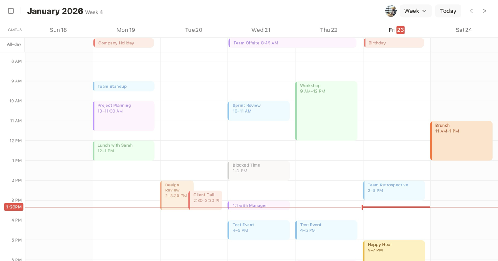

# CalendarCN

A calendar for React inspired by [Notion Calendar](https://www.notion.so/product/calendar). Built on [shadcn/ui](https://ui.shadcn.com), installed with the shadcn CLI, and yours to edit.

[](https://github.com/vmnog/calendarcn/actions/workflows/ci.yml) [](./LICENSE)

**[Live demo](https://calendarcn.xyz)** · **[Docs](https://calendarcn.xyz/docs)** · **[Roadmap](https://calendarcn.xyz/docs/roadmap)**

[](https://calendarcn.xyz)

## Features

- **Views**: day, week, any number of days from 2 to 9, and month.
- **Direct manipulation**: drag events to move them, drag their edges to resize, click an empty slot to create one. Works with touch too.
- **Real calendar data**: overlapping events side by side, all-day and multi-day events, a current-time indicator.
- **Event details**: a side panel or popover that matches Notion Calendar's details panel, with inline editing for the time and date, time zone, repeat, participants and rooms, conferencing, location, links and attachments, description, calendar, availability and reminders. Plus a right-click menu.
- **Keyboard first**: shortcuts for every view, a command menu, and keyboard move and resize for focused events.
- **Accessible**: labeled events, focus rings, and screen reader announcements when an event moves.
- **Configurable**: date-fns locale, 12 or 24 hour clock, week start, snap interval and visible hours.
- **Your data, your markup**: typed with your own event type, with render slots for event content and details.
- **Theming**: light and dark mode with the shadcn/ui CSS variables.

## Installation

Like shadcn/ui, CalendarCN isn't an npm package: the shadcn CLI copies the source into your project. Add the registry to your `components.json`:

```json
{
  "registries": {
    "@calendarcn": "https://calendarcn.xyz/r/{name}.json"
  }
}
```

Then add the full calendar, or only the pieces you need (`week-view`, `month-view`, `calendar-core` and more):

```bash
npx shadcn add @calendarcn/calendar
```

CalendarCN works with the Radix and the Base UI versions of the shadcn/ui components. The [installation guide](https://calendarcn.xyz/docs/installation) covers setup and every item.

## Usage

```tsx
import { Calendar } from "@/components/calendar";
import type { CalendarEvent } from "@/components/calendar-types";

export function MyCalendar({ events }: { events: CalendarEvent[] }) {
  return (
    <div className="h-[600px]">
      <Calendar defaultEvents={events} />
    </div>
  );
}
```

Or compose your own: wrap `DayView`, `WeekView`, `MonthView` or `TimeGrid` in `CalendarProvider`. The [docs](https://calendarcn.xyz/docs) have a live example and the API reference for each component.

## Development

You'll need Node.js 22+ and pnpm 10+.

```bash
git clone https://github.com/vmnog/calendarcn.git
cd calendarcn
pnpm install
pnpm dev
```

Open [localhost:3000](http://localhost:3000) for the demo and [localhost:3000/docs](http://localhost:3000/docs) for the docs.

## Contributing

Contributions are welcome, from typo fixes in the docs to new views. Read the [contributing guide](./CONTRIBUTING.md) to get set up, then look at issues labeled [`good first issue`](https://github.com/vmnog/calendarcn/issues?q=is%3Aissue%20is%3Aopen%20label%3A%22good%20first%20issue%22) or [open a new one](https://github.com/vmnog/calendarcn/issues/new/choose).

## Built with

[Next.js](https://nextjs.org), [React](https://react.dev), [Tailwind CSS](https://tailwindcss.com), [shadcn/ui](https://ui.shadcn.com), [date-fns](https://date-fns.org) and [Lucide](https://lucide.dev). The docs run on [Fumadocs](https://fumadocs.dev).

## License

[MIT](./LICENSE). Created by [Victor Nogueira](https://vmnog.com) ([@mevmnog](https://x.com/mevmnog)).
